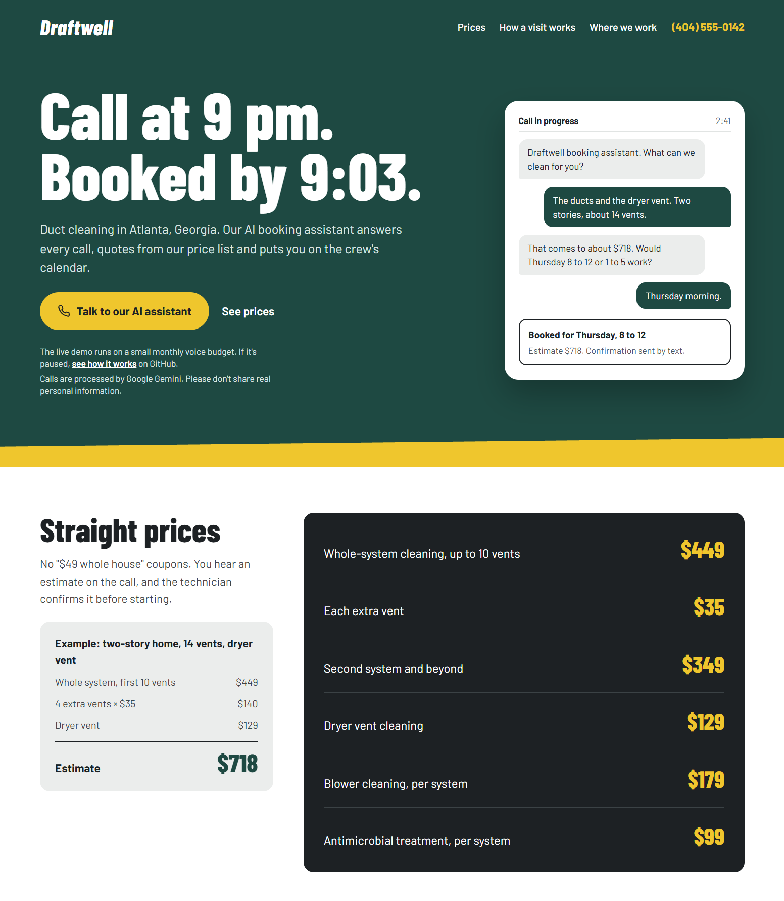
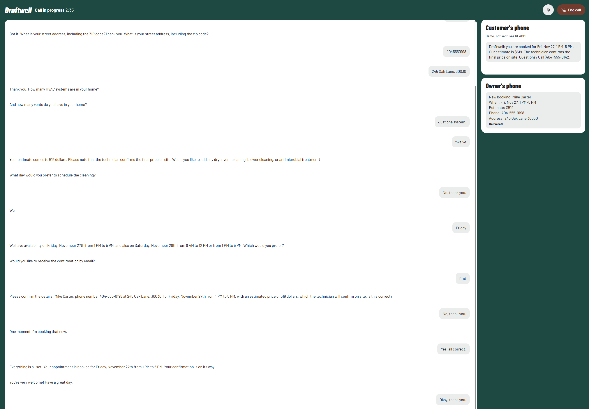
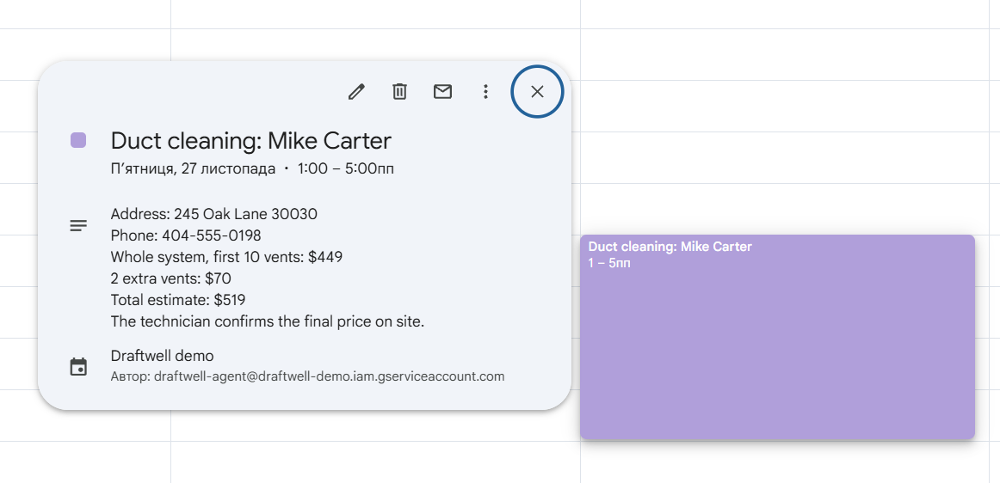
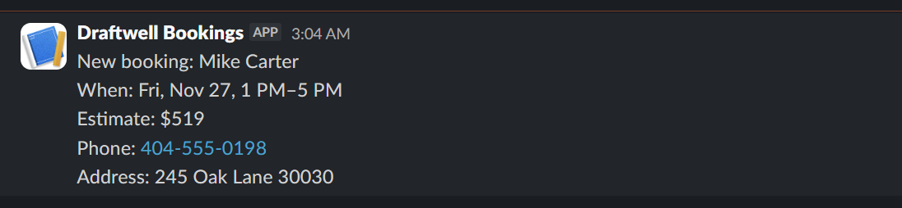
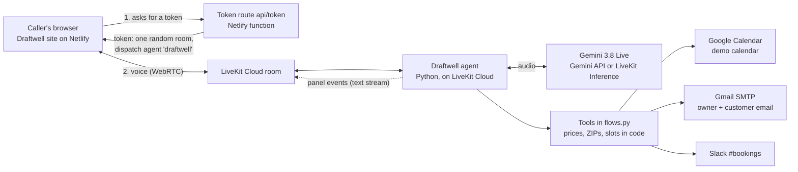

# Draftwell Voice Agent

[](https://github.com/AIglobalwork/draftwell-voice-agent/actions/workflows/ci.yml)

Small air duct cleaning companies in the US miss a lot of calls. The crew is on a job, it is evening, or it is the weekend. The customer does not leave a voicemail; they call the next company on the list. Draftwell is a voice AI agent that answers those calls 24/7. It checks the address, gives a price estimate, finds a free time, and books the job into the company calendar. The owner gets an email and a Slack message.

Draftwell is a fictional Atlanta company. This is a portfolio project. The agent, the website and the tests are all in this repository.

**My role:** I chose the problem, the niche and the stack, agreed the design spec and the plan with Claude, ran Claude Code task by task with a separate Claude chat reviewing each step, and made every live call to check the real calendar, emails and Slack. Claude Code wrote the code.

**Stack:** Python 3.12, LiveKit Agents, Gemini 3.8 Live (speech-to-speech) through the Gemini API or LiveKit Inference, Google Calendar API, Gmail SMTP, Slack webhook, Next.js 15 site on Netlify, pytest, Vitest, GitHub Actions.

## Demo

The screenshots are from a booking call on the live site on November 24, 2026 (LiveKit session `RM_PiHLaYkmU4Ms`).



*The company website. The yellow button starts a voice call in the browser.*



*The call: booked for Friday, November 27, 1-5 PM, with an estimate of $519. The caller's lines appear on the screen one step late, because Gemini sends the transcript of what the caller said at the end of the turn. In the session log the order is correct.*



*The same booking as an event in the demo Google Calendar, with the price breakdown.*



*The owner's notification in Slack.*

**A real call:** [`docs/call-transcript.md`](docs/call-transcript.md) is the transcript of another booking call, made on November 23, 2026. It shows the price bug that was fixed after that call (see [What happened along the way](#what-happened-along-the-way)).

**Live site:** https://draftwell-demo.netlify.app. Press "Talk to our AI assistant" and allow the microphone. The live demo runs on free tiers and a hosted voice model, so it may be paused or offline. The first call after a quiet period can take up to a minute to connect. If the agent does not join in that time, or leaves without speaking, the site says the live demo is paused.

## What a call does

- **Service area check.** The agent asks for the ZIP code and checks it against the list in [`agent/config/business.yaml`](agent/config/business.yaml).
- **Price estimate from code.** Systems, vents and add-ons go to `calculate_quote`, which uses the price list in [`agent/config/pricing.yaml`](agent/config/pricing.yaml). The model only repeats the result and always says the technician confirms the final price on site.
- **Free times from the calendar.** The agent offers only 4-hour windows that are free in Google Calendar, from tomorrow up to 14 days ahead.
- **Read-back.** Before booking, the agent reads back the name, phone, address, time, estimate and email (spelled letter by letter) and waits for "yes".
- **Booking.** The appointment becomes an event in a dedicated demo Google Calendar.
- **Notifications.** The owner gets an email and a Slack message. The customer gets a confirmation email if they gave one. The SMS the customer would get is shown in a panel on the site (see [Why SMS is simulated](#why-sms-is-simulated)).

If the caller wants a person, the agent takes a message for the owner. It does not give mold or repair advice, and it does not reschedule or cancel.

## Results

- **Voice cost, Gemini API Free tier (the live demo now):** $0. The limit is 65K input tokens per minute, so one call at a time is safe.
- **Voice cost, LiveKit Inference (the live demo until November 23, 2026):** $2.47 of credits for 27 minutes of calls in November 2026, about $0.09 per minute. The early figure of $0.02 per minute was a mistake.
- **Call cap:** every call ends at 5 minutes. The agent warns 30 seconds before the end, then says goodbye with the caller's microphone muted, so the goodbye cannot be cut off. This was checked in a call with the limit set to 60 seconds.
- **Offline tests:** 106 tests (November 2026) with no network and no keys. They cover the price calculation, the service area ZIPs, free slots and the schedule, double booking (losing and winning the race), notifications (a failed one never cancels a booking), the tools, the call timer and the voice provider settings.
- **Conversation tests:** 20 tests (November 2026) run the real instructions and tools on a Gemini text model. They check the tool calls, and an LLM judge checks most replies. They cover:
  - the price comes from the tool;
  - unknown vents lead to a question about square footage;
  - out-of-area ZIPs;
  - a caller who wants a person;
  - a mold question;
  - a discount request;
  - a slot taken during booking;
  - a message that could not be delivered;
  - "this Thursday" resolved from today's date;
  - the email offer, and an email spelled back and not asked for again;
  - no guessed titles;
  - an ambiguous slot choice;
  - "the confirmation is on its way";
  - no guessed ZIP code;
  - a day that was not offered is checked before the agent answers;
  - unclear speech is asked again.

  The last full run (November 24, 2026) passed 18 of 20. The two that failed are the unstable tests in [Known issues](#known-issues).
- **Web tests:** 12 Vitest tests (November 2026) for the token's scope, panel events, starting a call, the wait for a cold agent, the paused screen and the repository link.
- **CI:** GitHub Actions runs the offline agent tests, the web tests and the web build on every push and pull request.

## Architecture



| Folder | What is there |
|---|---|
| [`agent/`](agent) | The voice agent. `main.py` starts the session, `agent.py` has the instructions and thin tools, `flows.py` has the tool logic, the other modules hold prices, scheduling, calendar and notifications. |
| [`web/`](web) | The company website (Next.js, built from LiveKit's `agent-starter-react` template), the token route and the demo panel. |
| [`docs/`](docs) | The design spec (English; the Ukrainian original is in `docs/superpowers/specs/`), the implementation plan, the call transcript and the screenshots. |
| [`CLAUDE.md`](CLAUDE.md) | Project rules for the coding agent. |

## Key design decisions

- **Prices and dates are computed in code, never by the model.** `calculate_quote` returns the total and a breakdown. `book_appointment` books the last `get_quote` result of the call, which is the price the caller heard. It takes no prices, vents or add-ons from the model, and without a quote it books nothing. The model gets today's date in Atlanta time in its instructions, and free slots come from the calendar and the schedule in the config. `book` also refuses a ZIP outside the area, so that rule does not depend on the prompt.
- **Double booking is checked after the event is created.** Calls can run in separate processes, so an in-memory lock would protect nothing. `book_slot` checks the slot is free, creates the event, then re-reads the slot. If there are two events and ours is not the earliest (by creation time, then event id), it deletes ours and the agent offers other times. Two tests cover losing and winning that race.
- **A realtime speech-to-speech model.** Gemini Live hears and speaks in one model, so the conversation feels natural and the caller can interrupt. The trade-offs:
  - there is no separate text-to-speech, so fixed lines like the goodbye are generated by the model from an instruction;
  - the model detects the caller's speech on its server, so a reply cannot be marked "do not interrupt";
  - speech recognition can mishear names and emails, so the read-back before booking is the safety net;
  - the conversation tests run on a Gemini text model, so some mistakes only show up in voice calls.
- **The token route is public on purpose, but narrow.** There is no login, so anyone with the URL can start a call. Each token joins only its own new random room, dispatches only the `draftwell` agent, expires in 2 minutes if unused, and can publish only the microphone and data. A room holds at most 2 participants (caller and agent). The worst case is that someone uses up the free limits. The Gemini key is from an AI Studio project with no billing, and the LiveKit free plan has a hard cap and no card, so that costs $0.
- **Call time limit with a warning and a goodbye that cannot be cut.** Calls end at 5 minutes. 30 seconds before the end the agent says time is almost up. At the limit the caller's microphone is muted (so nothing can interrupt the goodbye), the agent says goodbye, and the room is deleted.
- **Notifications run in the background.** The agent hears "Booked" as soon as the calendar event exists, so there is no silence while emails and Slack are sent. If the caller hangs up, the agent still waits up to 20 seconds for them to finish. A failed notification never cancels a booking.

## How this was built with Claude Code

I built this with Claude Code as my coding agent. The process:

1. **Brainstorm and design spec.** The idea, the stack and the website design were agreed before any code. See [`docs/specs/`](docs/specs).
2. **Implementation plan.** 11 tasks plus a throwaway voice spike, each with exact files, tests and expected results. See [`docs/plans/`](docs/plans).
3. **Subagent-driven development.** For each task one subagent wrote the code test-first, and a separate reviewer subagent checked it against the plan and for quality. Findings went through a fix loop and a progress log. Rules for the agent are in [`CLAUDE.md`](CLAUDE.md).
4. **A separate planning chat with Claude.** It reviewed the plan and every task report, wrote the prompts I gave to Claude Code, and checked commits and deploys. Claude Code did the implementation.
5. **Manual checks by me.** I made all voice calls and checked the real calendar, emails and Slack.

### What happened along the way

Who did what is stated in each case.

- **A lock that would not lock.** The first plan prevented double booking with an in-memory lock. A plan review in my planning chat with Claude caught that LiveKit can run each call in its own process: the test with a fake calendar would pass and production would have no protection. It became the create-then-re-read check above.
- **An unverified mail server.** A review found that the SMTP connection did not verify the server certificate, so the Gmail password could be intercepted. It was fixed in a separate commit before the first real email went out.
- **"Your message was passed on" when it was not.** A reviewer found that the message tool always told the caller the message reached the owner, even when email and Slack both failed. Claude Code called it minor and proposed to defer it. I decided to fix it at once: a caller who asked for a person would wait for a call that never comes. Now the agent apologizes and reads out the company phone number.
- **A "flaky" test that was a real bug.** A conversation test failed now and then. Part of it was Gemini overload, but the model also quoted a price without asking for the square footage. Claude Code did not weaken the test. It added a rule to the instructions, as the plan required: fix the instructions, not the test.
- **Silence after "Yes".** In my first voice call the agent went quiet for 6-7 seconds after I confirmed, so I hung up, although the booking was made. The booking tool sent two emails and a Slack message before it answered. Claude Code moved the notifications to a background task and added timing logs for each step.
- **A Windows path in the Dockerfile.** `lk agent dockerfile` on Windows wrote the start path with backslashes. In the JSON form of `CMD`, `\d` is not valid, so the container would not start. Claude Code caught this before the first deploy.
- **The caller's first words.** The implementer of the public token route also turned off data publishing. The task reviewer noticed that LiveKit sends the audio recorded while the agent joins as a data stream, so the caller's first words would be lost. It was fixed before the site went live.
- **A goodbye that never played.** On the live site the goodbye at the time limit did not play; the call just ended. Claude Code checked the cloud logs: no timer error, so the goodbye had ended early. The caller's speech had interrupted it, and Gemini Live ignores the "do not interrupt" flag. The fix mutes the caller before the goodbye. A review of that fix in my planning chat with Claude caught that the new 30-second warning was outside the `try/finally`, so an error there would leave the call with no time limit. That was fixed with its own test.
- **A booking cheaper than the quote.** In the log of a real call (LiveKit observability), my planning chat with Claude noticed that the caller had agreed to $718 but the booking was saved with $589. The model had called the booking tool without the dryer vent, and the tool recomputed the price from what it was given. Claude Code reproduced it in an offline test first. Now `book_appointment` takes the last quote of the call.
- **A site that gave up too early.** Session events showed that after a quiet period the agent joined in 25-27 seconds, while the site gave up after 20 and showed the paused screen. Claude Code traced the 20 seconds to a default timeout in LiveKit's React library. Now the site waits 60 seconds and shows the status "Waking up the assistant".
- **Credits that ran out on day 6.** The estimate of $0.02 per minute was 4.5 times too low. The measured cost was about $0.09, so the month's credits ran out on the sixth day of testing and LiveKit Inference answered 429. That is why the live demo moved to the Gemini API.
- **Moving to the Gemini API.** The first connection failed with HTTP 404. Claude Code found the cause with systematic debugging: `google-genai` uses API version `v1` by default, and the model is served on `v1beta`. In my console calls, Gemini's server then did not notice the end of my sentences. Local turn detection fixed that, but the replies came one turn late. On the site, where the browser processes the audio, `server` mode works, so it is the default and `local` stays as an option.
- **English heard as German.** In a live call, English with an accent was recognized as German or Spanish ("Freitag Freitag morgen Wurst für mich"). In the same call the agent checked a ZIP code the caller had not said, and refused Friday without looking at the calendar. Claude Code added an `en-US` hint and three rules: ask again when something is unclear, do not guess a ZIP code, check a day that was not offered.

Other decisions that were mine: the niche and the stack (LiveKit over Vapi or a fully local setup, so all the work is visible in the repository), prices only in code, SMS off with the reason in the README, no video (screenshots and a real call transcript are the proof, so the README stands on its own when the live demo is offline), the website design, and keeping the `Co-Authored-By: Claude` line in commits.

## Run locally

You need Python 3.12 with [uv](https://docs.astral.sh/uv/), Node.js 22 or later, a LiveKit Cloud project (the free Build plan is enough), a Google service account with access to one calendar, a Gmail app password and a Slack incoming webhook.

1. Copy `.env.example` to `.env` in the repository root and fill it in. `GOOGLE_SERVICE_ACCOUNT_JSON` is the whole key file on one line, in single quotes. `.env` is git-ignored; never commit it.
2. Start the agent:

   ```bash
   cd agent
   uv sync
   uv run src/draftwell/main.py console   # talk to the agent in the terminal
   uv run src/draftwell/main.py dev       # or: wait for calls from the website
   ```

   By default voice calls use LiveKit Inference credits. To use the Gemini API instead, set `VOICE_PROVIDER=google` and `GOOGLE_VOICE_API_KEY` in `.env`.
3. Start the website in a second terminal:

   ```bash
   cd web
   cp .env.example .env.local   # LIVEKIT_URL, LIVEKIT_API_KEY, LIVEKIT_API_SECRET
   npm install
   npm run dev                  # http://localhost:3000
   ```

   The site dispatches the agent named `draftwell`. If the same agent is also deployed in your LiveKit project, the cloud agent may take the call instead of your local one.

## Tests

```bash
cd agent
uv run pytest -m "not llm"   # offline: prices, ZIPs, slots, double booking, notifications, tools, call timer
uv run pytest -m llm         # conversation tests on a Gemini text model (needs GOOGLE_API_KEY)

cd ../web
npm test                     # token scope, panel events, call start and wait, repository link
```

- **Offline tests** need no network and no keys. They use a fake calendar and recording senders.
- **Conversation tests** run the real instructions and tools on a Gemini text model through a free AI Studio key, so they spend no voice credits. They check that the agent calls the right tools and says the right things (an LLM judge checks most replies). The free tier allows 15 requests a minute, so there is a 15 s pause after each test (`LLM_TEST_PAUSE_SECONDS`). A full run takes about 6-7 minutes. Gemini sometimes answers 503 or 429; a single test can then fail for reasons outside the code.
- **CI** ([`.github/workflows/ci.yml`](.github/workflows/ci.yml)) runs the offline agent tests and the web tests and build on every push and pull request. The conversation tests are not in CI, because there is no API key on GitHub.

## Deploy

**Agent on LiveKit Cloud.** In `agent/`: `lk agent create` once (it writes `livekit.toml`), then `lk agent deploy` for each new version. LiveKit builds the image from the [`Dockerfile`](agent/Dockerfile), so Docker is not needed locally. Secrets go to LiveKit's secret store with `lk agent update-secrets`, separate from the code. Do not pass `LIVEKIT_*` (the cloud injects them) or the test-only `GOOGLE_API_KEY` and `TEST_LLM_MODEL`. At startup the agent logs whether the service account JSON arrived intact (only its shape, never its values). Check with `lk agent status` and `lk agent logs`.

**Voice provider.** The code uses LiveKit Inference by default (`VOICE_PROVIDER=livekit`). The live demo uses the Gemini API Free tier. These are its secrets, in a file outside the repository:

```
VOICE_PROVIDER=google
VOICE_TURN_DETECTION=server
GOOGLE_VOICE_API_KEY=<key from an AI Studio project with no billing>
```

```bash
cd agent
lk agent update-secrets --secrets-file <path to that file>
```

The command adds and updates secrets, keeps the others (do not pass `--overwrite`), and restarts the agent. To go back to LiveKit Inference:

```bash
lk agent update-secrets --secrets VOICE_PROVIDER=livekit
```

**Website on Netlify.** Import the repository with base directory `web`. Build settings and the Next.js adapter are in [`web/netlify.toml`](web/netlify.toml). Set `LIVEKIT_URL`, `LIVEKIT_API_KEY` and `LIVEKIT_API_SECRET` in Netlify (a separate LiveKit API key for the site is best). Every push to `main` deploys the site.

## Why SMS is simulated

In the US, any SMS an app sends from a 10-digit number needs A2P 10DLC registration with a company tax ID. The sole proprietor option is only for senders in the US and Canada. So the Twilio sending code is written but switched off (`SMS_ENABLED=false`), and the site shows the SMS the customer would get in the "Customer's phone" panel.

## Limits of the demo

- Voice runs on the Gemini API Free tier: 65K input tokens per minute for all visitors together, so one call at a time is safe. The key is from a project with no billing, so the worst case is $0.
- Noise cancellation (ai-coustics): 100 minutes a month on the LiveKit Build plan.
- LiveKit Inference, if switched back on: $2.50 of free credits a month (hard cap), about 27 minutes of calls at the measured cost.
- The live demo depends on the hosted voice model. If the model is overloaded or down, a call cannot start.
- A call lasts at most 5 minutes.
- Bookings go to a dedicated demo calendar. One crew, Monday to Saturday, 8 AM-12 PM and 1 PM-5 PM Atlanta time, from tomorrow up to 14 days ahead, closed on listed holidays.
- Service area: Atlanta, Decatur, Brookhaven, Sandy Springs, Dunwoody and Smyrna.
- English only. No rescheduling or cancelling: the agent offers to take a message for the owner instead.
- Every price is an estimate; the technician confirms the final price on site.
- The token route has no login and no rate limit, by design (see above). The free plan also has a cold start, so the first call after a quiet period can take up to a minute to connect.

## Known issues

- **npm advisories that need major upgrades.** `npm audit` in `web/` still reports PostCSS bundled inside Next.js 15 (used only at build time, on our own CSS; fixed only in Next.js 16) and KaTeX under `streamdown`, which renders the call transcript (fixed only in `streamdown` 2). Both need a major upgrade and are not done yet.
- **Voice-only mistakes.** The voice model sometimes mishears names or emails, or once paused for 6-7 seconds after an address. The read-back before booking catches wrong data. Some instruction rules were added after live calls; the text model used in tests already followed them, so those tests guard the rules but did not reproduce the original mistake.
- **The caller's lines appear late.** On the call screen they are one step behind, because Gemini sends the transcript at the end of the caller's turn. In the session log the order is correct.
- **Wrong language.** English with an accent can be recognized as another language. There is an `en-US` hint and a rule to ask again, but it can still happen.
- **Repeated sentences.** The agent sometimes says almost the same sentence twice. One case is at the top of the call screenshot.
- **A slot that was not clearly chosen.** If the agent did not hear which time the caller picked, it can go on without a clear choice. A fix is planned.
- **Two unstable conversation tests:** `test_ambiguous_slot_choice_is_confirmed` and `test_email_given_early_is_not_asked_again` sometimes fail.
- **Gemini Free tier limit:** 65K input tokens per minute, so several calls at the same time may not work.
- **Noise cancellation limit:** 100 minutes of ai-coustics a month on the Build plan.
- **Conversation tests depend on the Gemini free tier** and can fail on 503 or 429 errors.

## What I would do for a real client

These are next steps. None of them is built in this demo.

- **A real phone number.** Callers would dial a number (SIP through LiveKit telephony) instead of using the browser.
- **Per-client config.** Prices, ZIP codes and the schedule are already in YAML files in [`agent/config/`](agent/config). Each client would get its own config, calendar and notification channels.
- **Abuse protection and rate limiting.** The token route is open by design in the demo. A real client needs rate limits and bot protection on it.
- **CRM integration.** Bookings and messages would go into the client's CRM, not only to the calendar, email and Slack.
- **Real SMS.** The Twilio code is written. It would be switched on after A2P 10DLC registration under the client's company.
- **Monitoring and alerts.** Alerts on failed bookings, failed notifications and agent errors, plus call metrics.
- **A fallback voice model.** If the voice model is down or overloaded, the agent would switch to another one. Today the switch is manual: `VOICE_PROVIDER` picks the Gemini API or LiveKit Inference.

---

Draftwell is a fictional company. Its name, phone number and prices are made up for this demo.
